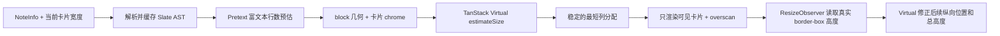

# 笔记瀑布流重构：Pretext 预估 + TanStack Virtual 实测校正

## 结论

瀑布流不再自行维护滚动监听、隐藏预渲染、MutationObserver 和卡片坐标缓存。新架构采用三层职责：

1. `@chenglou/pretext` 根据 Slate 内容提供低成本的初始高度估算。
2. `@tanstack/react-virtual` 负责可见范围、最短列分配、滚动锚定和绝对定位。
3. `ResizeObserver` 测量真实渲染高度，并让 Virtual 用真实值覆盖估算。

Pretext 不是最终尺寸的唯一真相。笔记包含图片、视频、音乐、代码块和复杂 Slate 布局，仅靠文本模型不可能长期与 CSS 完全同步；真实 DOM 尺寸才是最终值。这个“先估算、后测量”的组合既消除了隐藏预渲染，又避免估算误差累积成错位。

## 不变的 UI / UX 契约

本次重构只替换布局和测量机制，不修改视觉设计：

- 桌面卡片宽度仍为 `430px`，列间距与行间距仍为 `20px`，整体居中。
- 容器小于 `430px` 时仍退化为单列流体宽度。
- 卡片仍按预估高度分配到当前最短列，列分配一旦确定便保持稳定，避免真实尺寸回填时横向跳列。
- 正文仍最多展示 `30rem / 480px`，真实溢出时保留底部渐变遮罩。
- 卡片入场、hover、点击详情、拦截路由弹窗和返回后的滚动位置保持不变。
- 无限加载仍在列表底部前 `600px` 触发，并保留请求去重。
- 继续使用现有系统字体栈，不引入 WebFont，不改变字形、换行和首屏字体加载体验。

## 为什么推翻旧实现

旧 `ui/Masonry` 的每个新卡片都经历一次隐藏 DOM 渲染，再通过 MutationObserver 和 `getBoundingClientRect()` 读取高度，随后第二次渲染到可见区域。滚动时还会遍历全部记录，重新计算列高和可见范围。

主要成本和风险是：

- 新卡片至少渲染两次，Slate、图片和复杂 block 的构建成本被放大。
- DOM 写入后同步读尺寸容易触发布局计算。
- MutationObserver 在 React 批量提交下存在完成时序歧义。
- resize 会让既有测量和位置缓存大面积失效。
- 自研可见区、触底和坐标状态容易产生并发更新与陈旧闭包。

新实现删除整条隐藏预渲染链路，滚动阶段由 Virtual 维护可见项；`directDomUpdates` 直接更新容器高度和项目 `translate3d`，只有可见范围变化才触发 React 渲染。

## 数据流

### 1. 几何层

`ui/Masonry/layout.ts` 是纯函数，只计算：

- 当前列数；
- 卡片实际宽度；
- 瀑布流内容宽度；
- 居中偏移。

列数或卡片宽度变化时重建内部 virtualizer，避免跨响应式断点复用旧 lane 测量。普通滚动不执行全量坐标计算。

### 2. 高度估算层

`lib/note-card-estimator` 将卡片拆成固定 chrome 和内容两部分：

- 固定 chrome：padding、标题、底栏、section gap、封面 `3:1` 比例；
- 文本 block：paragraph、heading、quote、list、inline code、link 和 marks 通过 Pretext 富文本 API 估算行数；
- 几何 block：图片按保存的宽高比和百分比宽度估算；视频按 `16:9`；音乐、白板、Steam widget 等采用与现有组件接近的占位值；
- Slate layout 递归计算各列，并取最高列；
- 正文估算最终截断到 `480px`。

缓存分为两层：

- 按 note id + serialized content 缓存解析后的 Slate AST；
- 按 children 引用 + 文本变体缓存 Pretext prepared data。

resize 只重新执行廉价的宽度布局，不重复 prepare。列表过滤或数据删除后清理不再使用的 AST；`document.fonts.ready` 后清理文字度量缓存并重置 Virtual 测量。

系统字体在不同平台可能让 Canvas 估算与 DOM 有少量差异，这是有意接受的：改成固定 WebFont 会改变当前 UI，并增加网络、FOIT/FOUT 和字体切片维护成本。真实尺寸校正会消除最终布局误差。

### 3. 虚拟化与真实测量层

`ui/Masonry/index.tsx` 使用 window virtualizer，配置要点：

- `lanes` 对应响应式列数；
- `laneAssignmentMode: 'estimate'` 在初始估算阶段锁定列，避免回填真实高度时横向跳动；
- `measureElement` 使用 ResizeObserver 的 `borderBoxSize`，缺失时才回退到 `getBoundingClientRect()`；
- `directDomUpdates: true` + `transform` 将滚动位置更新放到 DOM/compositor 路径；
- overscan 根据当前卡片估算高度样本，将原有 `1200px` 缓冲目标动态换算为项目数量，并设置安全上下限；
- 底部 sentinel 使用 IntersectionObserver 和 `600px` root margin 触发加载。

这里是有意让 DOM 测量覆盖 Pretext 初始估算：Pretext 降低首次校正幅度，Virtual/ResizeObserver 保证媒体和任意 CSS 的最终正确性。不要再从 NoteCard 主动调用 `resizeItem`，否则会出现两个真实尺寸写入者。

### 4. 卡片折叠与详情路由

折叠渐变不再比较整张卡片高度，而是观察正文容器的 `scrollHeight` 与 `clientHeight`。ResizeObserver 同时观察正文容器和内部编辑器，因此图片、字体或异步 block 改变尺寸后仍会更新渐变状态。

打开 `/note/:id` 拦截路由时，列表中的对应卡片内容会暂时退出。Masonry 在每次真实测量时把最新高度写入外壳 CSS 变量，NoteCard 将它作为 `min-height` 占位；只有尚未完成首次测量时才回退到 Virtual 的估算值。这样可以防止瀑布流整体塌陷和后续卡片上跳，关闭详情后真实卡片重新参与测量。

## 失败与降级策略

- 非法 Slate JSON：估算器和真实渲染共用同一条解析逻辑与相同 fallback 文案。
- 缺少 `Intl.Segmenter`、Canvas 或 Pretext 运行异常：使用保守字符宽度估算，随后由真实 DOM 修正。
- 图片缺少原始宽高：使用 `128px` 最小高度占位，媒体加载后自动校正。
- 浏览器无 ResizeObserver：保留首次 `getBoundingClientRect()` 回退；目标浏览器均应原生支持 ResizeObserver。
- IntersectionObserver 不可用：首批数据仍会加载；该情况只作为旧环境降级，不作为目标浏览器体验。

## 验证标准

### 自动化

- 几何测试：多列居中、临界宽度、窄屏单列。
- 高度模型测试：空段落、相邻 margin、图片比例与最小高度、480px 截断和卡片 chrome。
- 估算器测试：有效/无效 Slate 内容、当前宽度传递与 fallback 一致性。
- 折叠测试：只有正文真实超过上限才出现渐变。
- 仓库门禁：`pnpm check`；依赖和运行时路径变化后执行 `pnpm build`。

### 浏览器回归

至少覆盖：

1. 430px 以下、单列、双列和三列响应式断点。
2. 短文、超过 480px 长文、无标题、封面、超长标题和多标签。
3. 图片加载前后、代码块、列表、引用、layout、视频和音乐 block。
4. 快速连续滚动、触底加载、筛选/搜索切换、删除和编辑后返回。
5. 打开详情弹窗、关闭弹窗、浏览器前进后退时无布局塌陷或明显跳动。

### 性能验收

不要用未经测量的绝对毫秒数作为结论。使用同一份长列表和同一浏览器，对重构前后各录制多轮 Performance profile，比较：

- 首批 20 张卡片的 React commit 数和主线程时间；
- 快速滚动时长任务、掉帧和 React render 次数；
- 新增一页数据时的 Layout / Recalculate Style 次数；
- resize 跨列数断点时的最大停顿；
- DOM 节点数量是否随总数据量线性增长。

预期结果是移除隐藏副本和全量滚动遍历，可见 DOM 数量由 viewport + overscan 决定；具体提升比例必须以 profile 为准。

## 依赖版本与参考

本次锁定：

- `@tanstack/react-virtual@3.14.9`
- `@chenglou/pretext@0.0.8`

参考以官方文档和源码为准：

- [TanStack Virtual：Text Measurement with Pretext](https://tanstack.com/virtual/latest/docs/pretext)
- [TanStack Virtual：Virtualizer API（lanes、laneAssignmentMode、measureElement）](https://tanstack.com/virtual/latest/docs/api/virtualizer)
- [Pretext 官方仓库与 rich-inline API](https://github.com/chenglou/pretext)
- [ResizeObserver 规范](https://drafts.csswg.org/resize-observer/)

## 后续可选优化

当前版本优先保证行为一致和可回滚。以下项目只有在 profile 证明有收益时再做：

- 记录并恢复 virtualizer snapshot，优化跨完整页面导航后的精确位置恢复；
- 用真实线上笔记构建估算误差分布，校准低频 block 的 fallback 常量；
- 对极长列表调整 overscan，但不以减少可见内容稳定性换取纸面指标；
- 当媒体 API 能稳定提供尺寸时，将更多 block 从常量估算改为元数据估算。
